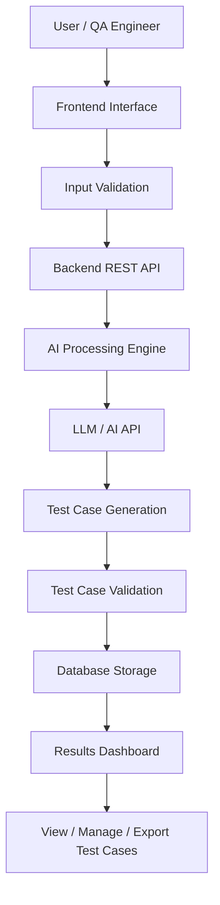

# 🧪 TestPilot AI – Intelligent Test Case Generator

**An AI-Powered Platform for Intelligent and Automated Software Test Case Generation**

## 📌 Overview

TestPilot AI is an intelligent software testing platform designed to simplify and automate the test case generation process using Artificial Intelligence.

The platform analyzes application requirements and user inputs to generate structured test cases, including positive scenarios, negative scenarios, boundary conditions, and edge cases.

By leveraging AI-driven analysis, TestPilot AI reduces manual testing effort, improves test coverage, and helps developers and QA engineers identify potential software defects at an early stage of the Software Development Life Cycle (SDLC).

## 🎯 Objectives

- Automate manual test case generation using AI.
- Improve software testing efficiency and accuracy.
- Identify positive, negative, and edge-case scenarios.
- Reduce repetitive testing activities.
- Improve test coverage and software quality.
- Provide an interactive platform for developers and testers.

## ✨ Key Features

### 1. AI-Powered Test Case Generation
- Automatically generates test cases from user requirements.
- Identifies functional testing scenarios.
- Generates positive and negative test scenarios.
- Detects boundary conditions and edge cases.

### 2. Test Studio
- Provides an interactive environment for managing test cases.
- Displays generated test cases in a structured format.
- Organizes test scenarios for easier review.

### 3. AI Tutor
- Helps users understand testing concepts.
- Provides explanations of generated test cases.
- Supports learning about software testing methodologies.

### 4. Voice Assistant
- Provides voice-based interaction.
- Improves accessibility and user interaction.

### 5. Test Case Management
- Displays generated test cases.
- Supports reviewing and organizing test scenarios.
- Helps improve test documentation.

## 🏗️ System Architecture

TestPilot AI follows a modular full-stack architecture consisting of the presentation layer, application layer, AI processing layer, and data layer.

### Architecture Diagram



### Architecture Components

**1. Presentation Layer**
- Provides an interactive user interface.
- Accepts application requirements and user inputs.
- Displays AI-generated test cases and results.

**2. Application Layer**
- Handles client-server communication.
- Processes incoming requests.
- Performs input validation and API management.
- Coordinates AI processing operations.

**3. AI Processing Layer**
- Communicates with the configured AI model through an API.
- Analyzes functional requirements.
- Identifies testing scenarios.
- Generates structured test cases.

**4. Data Layer**
- Manages application data.
- Stores user information and generated test cases when database integration is enabled.
- Supports data retrieval and management.

## 🔄 System Workflow

1. **User Input:** The user enters application requirements or testing instructions.
2. **Input Processing:** The backend receives and validates the input.
3. **AI Analysis:** The AI engine analyzes the requirements.
4. **Scenario Identification:** Positive, negative, and boundary scenarios are identified.
5. **Test Case Generation:** Structured test cases are generated.
6. **Validation:** Generated results are checked for completeness and formatting.
7. **Result Display:** Test cases are presented through the dashboard.
8. **Test Management:** Users can review and manage generated test cases.

## 🛠️ Technology Stack

The proposed technology stack includes:

| Component | Technology |
|---|---|
| Frontend | React.js |
| UI Development | HTML5, CSS3, JavaScript |
| Backend | Node.js |
| Server Framework | Express.js |
| Database | MongoDB |
| AI Integration | LLM API |
| API Communication | REST API |
| Development Environment | Visual Studio Code |
| API Testing | Postman |
| Version Control | Git and GitHub |

*Retain only the technologies and integrations actually implemented in your project.*

## 📂 Project Structure

A suggested modular project structure:

```text
TestPilot-AI/
│
├── client/
│   ├── public/
│   ├── src/
│   │   ├── components/
│   │   ├── pages/
│   │   ├── services/
│   │   ├── assets/
│   │   ├── App.jsx
│   │   └── main.jsx
│   └── package.json
│
├── server/
│   ├── config/
│   ├── controllers/
│   ├── routes/
│   ├── models/
│   ├── services/
│   ├── middleware/
│   ├── .env
│   ├── index.js
│   └── package.json
│
├── README.md
└── .gitignore
```

## ⚙️ Installation and Setup

### Prerequisites

- Node.js
- npm
- MongoDB (if database integration is enabled)
- AI API key for the configured provider
- Visual Studio Code

### Step 1: Clone the Repository

```bash
git clone <your-github-repository-url>
cd TestPilot-AI
```

### Step 2: Install Backend Dependencies

```bash
cd server
npm install
```

### Step 3: Configure Environment Variables

Create a `.env` file inside the server directory.

```env
PORT=4000
MONGODB_URI=your_mongodb_connection_string
JWT_SECRET=your_secret_key
GEMINI_API_KEY=your_ai_api_key
```

Use only the variables required by your actual implementation. Never upload API keys or secrets to GitHub.

### Step 4: Start Backend Server

```bash
npm start
```

### Step 5: Install Frontend Dependencies

Open another terminal:

```bash
cd client
npm install
```

### Step 6: Start Frontend Application

```bash
npm run dev
```

Open the local development URL displayed in the terminal.

## 🔐 Security Considerations

- Secure API key management using environment variables.
- Server-side input validation.
- Secure communication between frontend and backend.
- Authentication and authorization where implemented.
- Protection against unauthorized access.

## 🚀 Future Enhancements

- Automated test execution.
- Selenium and Playwright integration.
- AI-powered bug detection.
- Test coverage analytics and reporting.
- CI/CD pipeline integration.
- Multi-language test case generation.
- Integration with Jira and other test management platforms.
- Advanced AI-based test prioritization.

## 🎓 Learning Outcomes

Through the development of TestPilot AI, the following skills can be acquired:

- Full-stack application development.
- AI and API integration.
- Software testing methodologies.
- REST API development.
- Frontend and backend communication.
- Problem-solving and debugging.
- Software development lifecycle understanding.

## 👩‍💻 Project Information

**Project Name:** TestPilot AI – Intelligent Test Case Generator

**Domain:** Artificial Intelligence and Software Testing

**Project Type:** Full-Stack AI-Based Web Application

**Organization:** Indian Servers

**Institution:** Stanley College of Engineering and Technology for Women

**Department:** Computer Science and Engineering

## 📜 Conclusion

TestPilot AI demonstrates how Artificial Intelligence can transform traditional software testing by automating test case generation and improving testing efficiency. The platform provides an intelligent approach to identifying different testing scenarios, reducing manual effort, and supporting software quality assurance.

The project establishes a foundation for future enhancements in intelligent automation, AI-driven quality assurance, and continuous software testing.

---

**Developed as part of the Internship Project – 2026.**